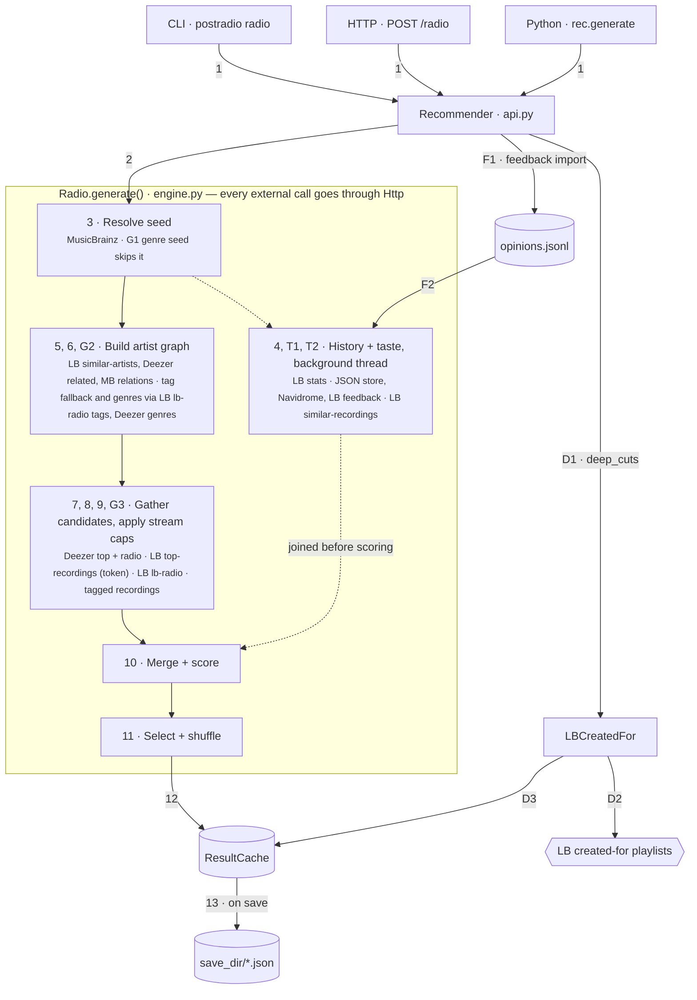

# Architecture

## Pipeline

Each request goes through `Recommender` (the library facade in `postradio/api.py`) into `Radio.generate()`
(`postradio/engine.py`). Arrow numbers give the execution order, and the table below explains each one.
Every external call goes through `Http` (`postradio/http.py`).



| Step | What happens |
|---|---|
| 1 | The caller enters through the CLI (`radio`), `POST /radio` or Python. All three call `Recommender.generate()`. |
| 2 | `Recommender` builds `Params` from the arguments plus config defaults, then calls `Radio.generate()`. |
| 3 | Resolve the seed through MusicBrainz: artist search or lookup, or a recording for `--track` / `--recording-mbid`. |
| 4 | Load history (LB all-time stats, a plays file, or none) in a background thread while steps 5–7 run. It reloads only when the provider's `version()` changes and is joined before scoring. |
| T1 | Load taste in the same background thread. Feedback providers in priority order (JSON store, Navidrome, LB) merge into a `Taste`: love ×1.5, hate ×0.3. A failing source is skipped. It reloads only when a provider's `version()` changes. |
| T2 | Track-boost layer: the 50 strongest track opinions, then their LB similar recordings, then per-track boosts, fetched in parallel. |
| 5 | Graph BFS out to `1 + round(2·explore)` hops over LB similar-artists, Deezer related artists and MusicBrainz band relations (hop 1 only). Each frontier's neighbour lists are fetched in parallel. |
| 6 | Sparse seed (fewer than 8 hop-1 artists): MusicBrainz tags (release-group tags as fallback), then troi tag radio adds up to 20 neighbours. |
| 7 | Catalogues for the seed and the shortlisted artists, in parallel: Deezer `/top`. Deezer identity is remembered per (name, MBID). A single exact-name hit is kept unless both LB and MusicBrainz titles disagree with it. Several same-named hits need 2 shared titles (LB first, then MusicBrainz). Matches expire with `storage.http_ttl_s`. |
| 8 | LB top-recordings, only with a token. LB listener counts (MBID-keyed) always set artist popularity; Deezer fan counts only fill gaps. Every candidate is labelled with its stream, and at the end each whole stream is cut once by `advanced.mix` / `--mix` (see below). |
| 9 | Radio for the seed and its 3 closest hop-1 artists: Deezer artist radio and LB-radio (easy/medium/hard by explore), in parallel. Each stream gets its own RNG from `--rng-seed`, so runs reproduce. |
| 10 | Merge duplicates, then drop junk titles and already-played tracks (`--unheard artists` also drops known artists). Then score. |
| 11 | Select greedily with a per-artist cap and a soft 50 % per-source cap, then shuffle within bands of 10. |
| 12 | Store the result in the in-memory `ResultCache` under a `result_id` (1 h TTL, 50 items). |
| 13 | `save(result_id)` writes the JSON into `storage.save_dir`, only when asked. |
| G1 | Genre seed: a virtual artist (key prefixed `~`), with no MusicBrainz lookup and no seed catalogue or seed radio. |
| G2 | Hop 1 comes from genre artists: LB tag radio (`lb-tags`) and Deezer `/genre/{id}/artists`. With AND, it's the intersection. |
| G3 | Up to 100 tagged recordings are injected as candidates. |
| F1 | `postradio feedback import` / `POST /feedback` appends a dated batch to `opinions.jsonl`. |
| F2 | Step T1 reads it back as the `json` source (first priority): the newest opinion per item, from the newest 5000 lines. |
| D1 | `deep-cuts`: `Recommender.deep_cuts()` calls `LBCreatedFor`. |
| D2 | Fetch the LB created-for listing (cached 1 h) and each playlist body. |
| D3 | Each week becomes a separate entry in the same `ResultCache`, saveable the same way. |

## Scoring

```
score = affinity × hop_fit × artist_pop_fit × track_pop_fit × familiarity
        × artist_taste × track_taste × similar_boost × (1 + 0.2 per extra source) × jitter
```

- **affinity**: the best path through the graph, as the product of edge weights. An artist reached from
  more than one source gets ×1.15.
- **hop_fit**: a bell curve around a target hop of `3·explore`.
- **track_pop_fit**: a bell curve around the popularity target (`--popularity`, otherwise `1 − 0.85·explore`).
- **artist_pop_fit**: penalises only artists more popular than a ceiling. Without the slider, the ceiling
  also stays within `seed popularity + 0.2`, so obscure seeds stay obscure.
- **familiarity**: artists in your history are weighted down as explore rises. Played tracks are dropped
  at explore ≥ 0.3, or always with `--unheard`.
- **taste**: `love_factor ** score` for a positive score, `hate_factor ** −score` for a negative one, for
  both artists and tracks.

## Stream caps

Each candidate stream (`deezer-top`, `lb`, `deezer-radio`, `troi`, `track-sim`, `lb-tags`) has a cap from
0 to 1 in `advanced.mix` (per run: `--mix`). A cap applies to the whole stream across all artists and
calls. It keeps `round(len × cap)` candidates, those nearest the popularity target. `track-sim` instead
keeps LB's most-similar-first order, and a capped-away similar recording leaves no boost behind.

Caps shrink pools; they don't set playlist shares. 20 % of about 1,000 catalogue candidates is still far
more than 30 slots, so the final mix moves noticeably only from about 0.05. Measured on a Kendrick Lamar
seed (explore 0.5, n 30), the counts for deezer-top / lb / radio / troi were:
- default: 27 / 12 / 4 / 3
- catalogue caps at 0.2: 25 / 10 / 5 / 2
- catalogue caps at 0.05: 16 / 5 / 4 / 6

## Concurrency

- Each `Radio` has one shared thread pool (`fetch_workers`, 8). Graph building and the background
  history/taste load both use it.
- `Http` gives every host its own start spacing and cap on requests in flight. It honours LB's
  `X-RateLimit` headers and retries with backoff.
- Pool threads carry a thread-local flag. A fetch started from inside a pooled job runs inline, so
  nested fetches can't deadlock a full pool.
- Graph mutation stays single-threaded.
- `Radio` and `Recommender` have `close()` and work as context managers. The server releases its
  `Recommender` in a FastAPI `lifespan` context on shutdown.
