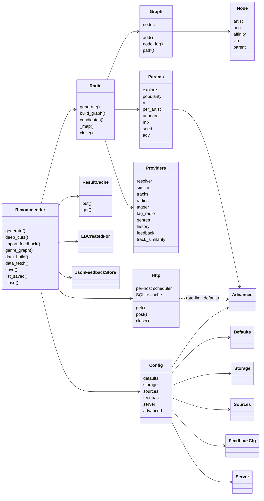

# Classes

Data crosses between modules only as the normalised types in `postradio/models.py`. Raw API payloads never
leave the adapters. The engine talks only to the interfaces in `postradio/providers/__init__.py`.

## Models and interfaces

```mermaid
classDiagram
    direction LR
    class Artist {
        name
        mbid
        deezer_id
        popularity
        virtual
        key
        absorb()
    }
    class Track {
        title
        artist
        recording_mbid
        deezer_id
        popularity
        sources
        key
    }
    class Edge {
        target: Artist
        weight
        source
    }
    class Play {
        artist
        title
        timestamp
        artist_mbid
        recording_mbid
    }
    class History {
        plays(artist)
        heard(track)
        from_plays()
        from_counts()
    }
    class Feedback {
        artist
        title|None
        score -1..1
        source
        mbids
    }
    class Taste {
        artist(a)
        track(t)
        strongest(n)
    }
    Track --> Artist
    Edge --> Artist
    History ..> Play : built from
    Taste ..> Feedback : built from

    class ArtistResolver {
        <<interface>>
        find_artist()
        artist_by_mbid()
        find_recording()
        recording_by_mbid()
    }
    class SimilarArtists {
        <<interface>>
        neighbours(artist, limit)
        max_hop
    }
    class TopTracks {
        <<interface>>
        top_tracks(artist, limit)
    }
    class RadioSource {
        <<interface>>
        radio(artist, popularity, mode, rng)
    }
    class Tagger {
        <<interface>>
        tags(artist, n)
    }
    class TagRadio {
        <<interface>>
        artists_for_tags()
    }
    class GenreSource {
        <<interface>>
        genre_artists()
        genre_tracks()
        supported_genres()
        unsupported()
    }
    class TrackSimilarity {
        <<interface>>
        similar(track, limit)
    }
    class HistoryProvider {
        <<interface>>
        load()
        version()
    }
    class FeedbackProvider {
        <<interface>>
        load()
        version()
    }
```

## Adapters (what implements what)

| Adapter | ArtistResolver | SimilarArtists | TopTracks | RadioSource | Tagger | TagRadio | GenreSource | TrackSimilarity | HistoryProvider | FeedbackProvider |
|---|:-:|:-:|:-:|:-:|:-:|:-:|:-:|:-:|:-:|:-:|
| `MusicBrainz` (+ optional local store) | ✓ | ✓ (hop 1 only) | | | ✓ | | ✓ (store or index only) | | | |
| `Deezer` | | ✓ | ✓ | ✓ | | | ✓ | | | |
| `LBSimilar` | | ✓ | | | | | | | | |
| `LBTopTracks` (token) | | | ✓ | | | | | | | |
| `TroiRadio` | | | | ✓ | | | | | | |
| `TroiTagRadio` (lb-tags) | | | | | | ✓ | ✓ | | | |
| `LBSimilarRecordings` | | | | | | | | ✓ | | |
| `ListenBrainzHistory`, `FileHistory`, `NoHistory` | | | | | | | | | ✓ | |
| `JsonFeedbackStore`, `LBFeedback`, `NavidromeFeedback` | | | | | | | | | | ✓ |
| `YandexLikes` (+ `as_history()`) | | | | | ✓ | | | | ✓ (via `as_history()`) | ✓ |
| `YandexSimilar` | | ✓ (liked artists only) | | | | | | | | |

| Module | Classes |
|---|---|
| `providers/musicbrainz.py` | `MusicBrainz` (store first, API fallback; `genre_names()` for the data build) |
| `providers/musicbrainz_store.py` | `ArtistStore` (read side of `mb_artists.sqlite`), `GenreIndex` (`genre_artists.json`), `import_dump()` (builds the store from the JSON dump) |
| `providers/listenbrainz.py` (data build) | `LBData` (sitewide top artists, artist genres in batches of 50; no interface) |
| `data.py` (not a provider) | `build`, `fetch`, `status`, `package`; `BuildOptions` |
| `providers/yandex.py` | `YandexClient` (public playlist with paging, similar artists; `.ru` then `.net`), `YandexLikes`, `YandexSimilar`; `genre_table()` reads `postradio/data/yandex_genres.json` |
| `providers/wikidata.py` | `Wikidata` (genre graph via SPARQL; data build only, no interface) |
| `genres.py` (not a provider) | `GenreGraph`, `GenreNode`, `GenreScore`; pure functions `spread`, `cotag`, `similar`, `combine`, `yandex_edges` |
| `providers/deezer.py` | `Deezer` (Deezer identity check: free LB titles first, MusicBrainz titles only when needed) |
| `providers/listenbrainz.py` | `LBSimilar`, `LBTopTracks`, `LBSimilarRecordings`, `TroiRadio`, `TroiTagRadio`, `LBMetadata` |
| `providers/lb_playlists.py` | `LBCreatedFor` (Weekly Exploration / Jams; no interface, called directly) |
| `providers/history.py` | `ListenBrainzHistory`, `FileHistory` |
| `providers/feedback.py` | `LBFeedback`, `NavidromeFeedback` |
| `providers/feedback_store.py` | `JsonFeedbackStore` |

## Engine, API and infrastructure

`server.py` and `cli.py` are thin wrappers around `Recommender`.
