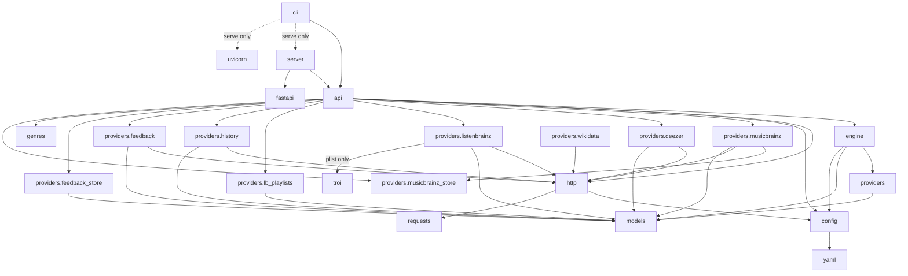

# Dependencies

## Module imports

Arrows point from the importer to the imported module. `cli` imports `server` and `uvicorn` lazily, only
for `serve`.

## External services

| Adapter | Host and endpoints | Auth | Limits and notes |
|---|---|---|---|
| `MusicBrainz` | `musicbrainz.org/ws/2`: artist search/lookup, recording, release-group, artist-rels, tags | none | **1 req/s**: 1.1 s spacing, 1 request in flight, 5 attempts, backoff 2–30 s on 503/429 (nothing after the last attempt). About 4 calls per cold run. |
| `ArtistStore` (optional) | local `mb_artists.sqlite`, built from `data.metabrainz.org` JSON dump `artist.tar.xz` (~1.7 GB) | none | No network at run time; opened read-only. About 600 MB on disk. |
| `Wikidata` | `query.wikidata.org/sparql`: three SPARQL queries (ancestors, labels, influences) | none | Data build only. 1 req/s, 1 in flight, 180 s timeout. Each query must stay under Wikidata's 60 s limit, or the answer comes back cut off mid-JSON; `Http` retries a body it can't parse. |
| `Deezer` | `api.deezer.com`: `/search/artist`, `/artist/{id}/top`, `/related`, `/radio`, `/genre`, `/genre/{id}/artists` | none | 0.12 s spacing, 6 in flight. The quota error (code 4) is retried; "no data" (code 800) is cached as an answer; any other error body is returned uncached. |
| `LBSimilar` | `labs.api.listenbrainz.org/similar-artists/json` | none | 0.1 s spacing, 4 in flight |
| `LBTopTracks` | `api.listenbrainz.org/1/popularity/top-recordings-for-artist` | **token** | Wired in only when a token is set. It is the authoritative artist popularity. |
| `TroiRadio`, `TroiTagRadio` | `/1/lb-radio/artist/{mbid}`, `/1/lb-radio/tags`, then `POST /1/metadata/recording/` | none | Goes through `Http`; troi's `plist` maths picks recordings, seeded from `--rng-seed`. Tag search also serves genre seeds. |
| `ListenBrainzHistory` | `/1/stats/user/{u}/artists`, `/recordings` (all time) | none (token optional) | Public profiles; up to 1000 artists / 5000 tracks. Pages after the first are fetched in parallel. Reloads at most daily. |
| `LBCreatedFor` | `/1/user/{u}/playlists/createdfor`, `/1/playlist/{mbid}` | none (token optional) | Listing cached 1 h, playlist bodies 7 days |
| `LBSimilarRecordings` | `labs.api.listenbrainz.org/similar-recordings/json` | none | Taste layer and track seeds |
| `LBFeedback` | `/1/feedback/user/{u}/get-feedback` | none | Loves +1, hates −1, cached 15 min |
| `NavidromeFeedback` | `{url}/rest/`: `getStarred2`, `search3` (walks the library), `getArtists` | Navidrome user + password (Subsonic salted token) | Auth errors are never cached |
| `JsonFeedbackStore` | local `opinions.jsonl` (+ `.batches.jsonl` index) | none | No network; reads only the file's tail |

LB's API host (`api.listenbrainz.org`) is also spaced at 0.34 s with 4 in flight. Its `X-RateLimit`
headers (30 requests per ~10 s window) are honoured: when `Remaining` drops to 2, every thread waits for
the window to reset.

## Cost of one run (measured)

Cold cache, Radiohead, explore 0.6, n = 50, with a token and an LB user:

| | Sequential version | Now |
|---|---|---|
| Cold run wall time | ~130 s | ~30 s |
| Requests | ~275 | 238 (Deezer 109, LB labs 65, LB 62, MusicBrainz 2) |
| Warm rerun (everything cached) | 0.7 s | ~1 s, 0 requests |
| Peak RAM | < 100 MB | ~112 MB |
| Disk | | ~16 MB of HTTP cache per new cold seed (7-day TTL); venv ~270 MB |

## Deezer genres (fixed list)

Pop · Rap/Hip Hop · Reggaeton · Rock · Dance · R&B · Alternative · Christian · Electro · Folk · Reggae ·
Jazz · Country · Salsa · Traditional Mexicano · Classical · Films/Games · Metal · Soul & Funk ·
African Music · Asian Music · Blues · Brazilian Music · Cumbia · Indian Music · Kids · Latin Music

"Rap/Hip Hop" also matches "rap" and "hip hop". Any other genre works only through LB tags. With
`--genre-op and`, a genre Deezer doesn't know makes Deezer contribute nothing for the query, and the
run logs this along with Deezer's supported list.
